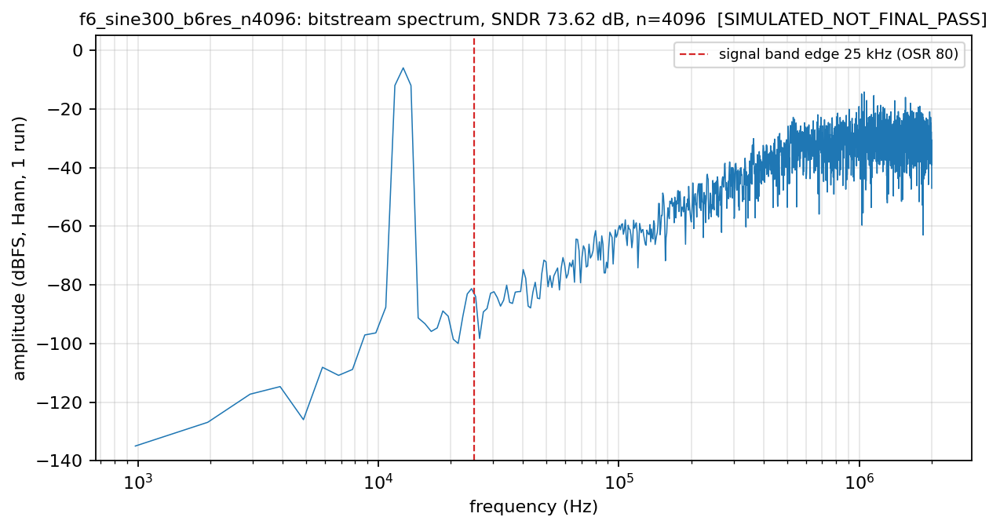
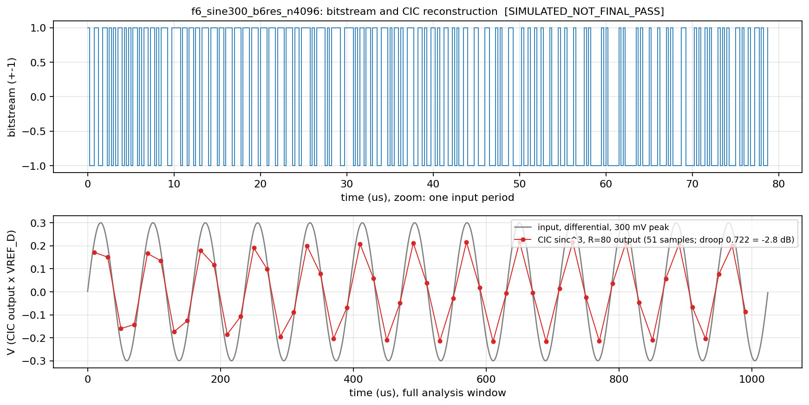
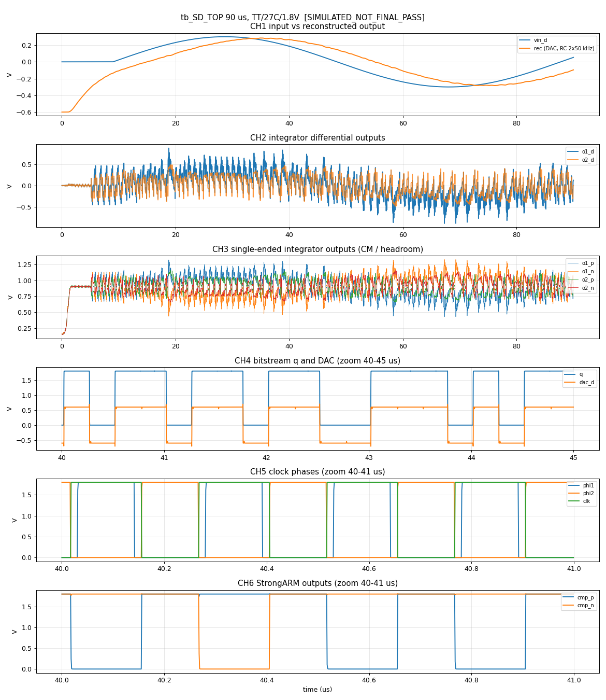
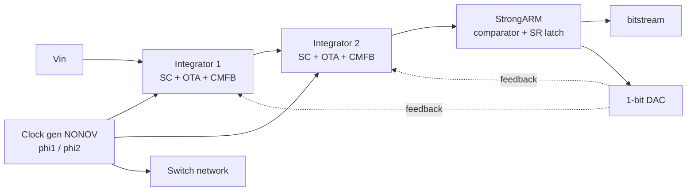

# Mixed-Signal Delta-Sigma ADC (SKY130)


Transistor-level design of a **1.8 V, 2nd-order, switched-capacitor, 1-bit Delta-Sigma modulator** in the open-source SKY130 PDK, from individual analog blocks to a closed-loop transistor-level simulation, with a Python flow that drives ngspice and extracts SNDR from the bitstream.

> **Scope, stated plainly:** all results below are **simulation, nominal corner (TT, 1.8 V, 27 C), pre-layout** unless a section says otherwise. Nothing here is silicon-proven or post-layout. The loop is **not** robust over process corners yet (see "Corners"). Known limits are listed at the end, not hidden.

## How it works, in short

The modulator samples the differential input at 4 MHz and outputs **one bit per clock**. Two switched-capacitor integrators accumulate the difference between the input and the fed-back 1-bit DAC level, and the comparator decides the next bit. The *density* of ones follows the input (about 50 % + Vin / 1.2 V), while the quantization error is pushed to high frequencies (2nd-order noise shaping, +40 dB/decade). A digital decimation filter (sinc^3 CIC, R = 80, plus a droop-compensation FIR) then removes the out-of-band noise and returns 50 kS/s multi-bit samples with a 25 kHz bandwidth.

## Result in one table

Closed-loop transistor-level run, 300 mV differential sine (-6 dBFS, 12.7 kHz), OSR 80 (25 kHz bandwidth), 4112 clock cycles, 4096-point FFT:

| Configuration | SNDR @ OSR 80 |
|---|---|
| Ideal clock phases and comparator clock (Block 5 baseline) | 75.37 dB |
| Phases generated by Block 6 (NONOV), ideal comparator clock | 73.87 dB |
| Phases from Block 6 and comparator clock derived from its phi2b edge | 72.44 dB |
| **As above, Block 6 biased by its own resistor bias (run f6, current reference)** | **73.62 dB (ENOB 11.94 bit)** |
| Behavioral model, same loop coefficients, ideal components | 77.16 dB |

System target (revised after analysis): **about 75 dB SNDR at OSR 80**. A 2nd-order 1-bit modulator cannot reach the original 99 dB at OSR 80, so the target was revised on that basis rather than claiming it. Noise shaping of order 2 is preserved in all runs. The 1-3 dB differences between rows are at the level of single-run statistical scatter (about +-1 dB at OSR 80), so they are reported but not claimed as a degradation.

Simulated supply current of the loop (TT, f6 configuration, ideal bias sources): about 268 uA from 1.8 V (0.48 mW), almost all in the two integrators.





The same loop as an Xschem system testbench (`top_level/xschem/tb_SD_TOP.sch`, reproduces f6 bit for bit over 20 us), seen as on an oscilloscope:



## Corners

Full report: [top_level/closed_loop/docs/corner_study_f7.md](top_level/closed_loop/docs/corner_study_f7.md).

| Corner | Bias | SNDR @ OSR 80 |
|---|---|---|
| TT / 27 C / 1.8 V (f6) | fixed | 73.62 dB |
| SF / 125 C / 1.98 V | fixed | 28.17 dB |
| SF / 125 C / 1.98 V | tracking (ideal sources re-computed per corner) | 77.44 dB |
| FS / -40 C / 1.62 V | fixed | 33.58 dB |
| FS / -40 C / 1.62 V | tracking | fails (loop stuck) |

Two causes were found and proven: at SF the fixed bias voltages do not track PVT (tracking bias restores the loop; a real bias generator is still to be designed), and at FS the PMOS input pair of the OTA has no headroom at the 0.9 V common mode, which no bias can fix (a low-Vt input pair removes the limit in a DC check, not yet verified in the loop).

## Architecture



| # | Block | Content | Report |
|---|---|---|---|
| 1 | OTA | Two-stage fully differential amplifier (Rabii and Wooley style); 69.34 dB gain, 3.153 MHz UGF, 61.4 deg phase margin in the characterized configuration | [EN](blocks/01_OTA/docs/Block1_OTA_Report_EN.pdf) / [ID](blocks/01_OTA/docs/Block1_OTA_Report_ID.pdf) |
| 2 | SC-CMFB | Switched-capacitor common-mode feedback | [EN](blocks/02_CMFB/docs/Block2_SC_CMFB_Report_EN.pdf) / [ID](blocks/02_CMFB/docs/Block2_SC_CMFB_Report_ID.pdf) |
| 3 | StrongARM + SR latch | Dynamic comparator | [EN](blocks/03_StrongARM/docs/Block3_StrongARM_Report_EN.pdf) / [ID](blocks/03_StrongARM/docs/Block3_StrongARM_Report_ID.pdf) |
| 4 | 1-bit DAC | Rail-to-rail feedback multiplexer | [EN](blocks/04_1Bit_DAC/docs/Block4_DAC_Report_EN.pdf) / [ID](blocks/04_1Bit_DAC/docs/Block4_DAC_Report_ID.pdf) |
| 5 | Switch network | CMOS transmission gates, charge-injection and hold-error analysis | [EN](blocks/05_Switch_Network/docs/Block5_SwitchNetwork_Report_EN.pdf) / [ID](blocks/05_Switch_Network/docs/Block5_SwitchNetwork_Report_ID.pdf) |
| 6 | Clock generator (NONOV) | Feedback-free non-overlapping two-phase generator after Spilka et al., DDECS 2012; current-starved delay cells, 80 MOS | [EN](blocks/06_Clock_gen/docs/Block6_ClockGen_Report_EN.pdf) / [ID](blocks/06_Clock_gen/docs/Block6_ClockGen_Report_ID.pdf) |
| 7 | sinc^3 CIC decimator (digital) | Hogenauer CIC, R = 80, 20-bit, no multipliers; bit-exact RTL vs Python model (RTL simulation) | [README](blocks/07_Digital_CIC/README.md) |
| 8 | Compensation FIR (digital) | 21-tap FIR that flattens the CIC droop on 0-15 kHz (-0.115/+0.028 dB); serial MAC, one 18x18 multiplier (RTL simulation) | [README](blocks/08_Digital_FIR/README.md) |

Every block was closed with an explicit scope statement and measured numbers labelled `MEASURED_NOT_FINAL` or `SIMULATED_NOT_FINAL_PASS`, never an unqualified "pass".

## Block 6 in numbers (nominal)

Non-overlap gap 14.3 ns, phase width 110.6 ns (T = 250 ns), zero overlap, edges 0.3-0.8 ns. Wire loads of 50/200/500 fF keep the gap at 14.3-14.7 ns with no overlap.

**PVT baseline (ideal fixed bias, VBN 0.70 V / VBP 0.71 V), 45 conditions** (5 corners x -40/27/125 C x 1.62/1.8/1.98 V): zero overlap in all 35 conditions where the clock runs, but only 17 of 45 meet gap >= 5 ns and width >= 100 ns; 10 conditions stop producing phases (cold or low VDD), 18 fail on a collapsed gap (hot, high VDD) or a clipped width. The delay cell is very sensitive to bias at fixed gate voltage, so a PVT-tracking bias generator is the identified next step; a bias map that finds VBN/VBP per condition is in progress. This is recorded as a known limit, not as a pass.

## Repository structure

```
blocks/01_OTA ... 06_Clock_gen   analog blocks: schematics (xschem), testbenches, per-block docs
blocks/07_Digital_CIC            sinc^3 CIC decimator: RTL, Icarus testbench, bit-exact Python model
blocks/08_Digital_FIR            CIC droop-compensation FIR: RTL, Icarus testbench, bit-exact Python model
top_level/xschem                 SD_TOP (Blocks 1-6 connected) and the system testbench tb_SD_TOP
top_level/closed_loop            closed-loop modulator runs, Python drivers, results, corner study (docs/)
tools/                           Python generators and runners for the testbenches
docs/README.md                   index of all reports and READMEs
```

## Reproducing

Needs xschem, ngspice (46) and the SKY130A PDK. Block 6 example, from the repository root:

```
python3 tools/run_block6.py selftest
python3 tools/run_block6.py netlist --xschem <path-to-xschem>
python3 tools/run_block6.py sim
python3 tools/run_block6.py analyze
```

Closed-loop drivers are documented in `top_level/closed_loop/README.md`. Large raw waveform files are not committed (see `.gitignore`).

## FPGA demonstration: what it shows and what it does not

Blocks 1-6 are transistor-level analog circuits (OTA, SC-CMFB, StrongARM comparator, 1-bit DAC, switches, clock generator). **They cannot be placed in an FPGA**, which contains only digital logic. They are verified in SPICE only (closed-loop runs and `top_level/xschem/tb_SD_TOP.sch`). Only the digital back end (Block 7 CIC, Block 8 compensation FIR) runs on the Tang Nano 20K.

The FPGA work is staged, and each stage is labelled for what it really is:

| Stage | Runs on the FPGA | Source of the modulator data | What it proves | Label used in this repository |
|---|---|---|---|---|
| 1 | ROM with the bitstream -> CIC (Block 7) -> FIR (Block 8) -> on-chip comparison with golden data -> LED pass/fail | the **transistor-level bitstream from SPICE** (closed-loop run f6, 4096 bits), replayed | the synthesized and placed digital back end matches the bit-exact model on real hardware | "FPGA demo replays the transistor-level bitstream (SPICE)" |
| 2 | the same chain, replayed continuously, samples sent to an STM32F407 -> DAC -> oscilloscope | the same SPICE bitstream, replayed | the reconstructed 12.7 kHz tone of the simulated modulator is visible on a real oscilloscope | "FPGA demo replays the transistor-level bitstream (SPICE)" |
| 3 (optional) | a fixed-point behavioral model of the 2nd-order modulator, driven by a digital sine (NCO), -> CIC -> FIR, live | an **ideal mathematical model**, not the circuit | the full chain runs in real time | "live behavioral model (ideal), not the analog circuit" |

Why the distinction matters: the behavioral model has no finite OTA gain or slew, no common-mode feedback, no comparator offset, no switch charge injection, no clock skew and no process, voltage or temperature dependence. In this project the ideal model gives 77.2 dB SNDR where the transistor-level loop gives 73.6 dB (run f6), and the FS / -40 C / 1.62 V corner failure found in the transistor-level simulation (input pair of the OTA without headroom) cannot appear in the model at all. Only the replayed SPICE bitstream (stages 1-2) carries the behavior of the actual analog circuit into the FPGA, as a recording rather than live. Real analog behavior on silicon would need a fabricated chip, which this project does not have.

## Known limits

- Pre-layout only. The closed loop is verified at TT and diagnosed at two corners (SF/125 C/1.98 V and FS/-40 C/1.62 V); FS fails and is not fixed. Block 6 additionally has the PVT baseline above. No Monte Carlo of the loop, no post-layout, no transient noise in the decks.
- OTA and CMFB bias voltages, VCM and VREF are ideal sources; no bias generator yet. Block 6 is biased by a resistor (RB1) and current mirrors in run f6.
- The sampling, integration and DAC capacitors of the integrators (Cs 1 pF, Cf 2 pF, Cd 1 pF) are ideal capacitors in the loop deck; the OTA compensation and CMFB capacitors are MIM devices.
- Closed loop: one amplitude (-6 dBFS), one bin, one run per configuration; single-run SNDR scatter is about +-1 dB at OSR 80 and about 3 dB at OSR 16.
- The OTA inside the loop is not exactly the OTA characterized in Block 1 (different Cc and bias); Block 1 numbers do not transfer automatically.
- The comparator clock derived from phi2b uses an inverter chain (N = 2, 0.46 ns); a deliberately designed comparator delay is not done.

## Roadmap

In the repository (RTL simulation, `SIMULATED_NOT_FINAL_PASS`): Block 7 sinc^3 CIC decimator (`blocks/07_Digital_CIC/`) and Block 8 droop-compensation FIR (`blocks/08_Digital_FIR/`), both bit-exact against Python models with self-checking Icarus testbenches.

Done in simulation: corner diagnosis of the closed loop (report linked above).

Next: FPGA stages 1-2 above (Tang Nano 20K, then STM32F407 + DAC + oscilloscope), optional stage 3. Then: fix of the FS input headroom (low-Vt input pair), a real bias generator, MIM arrays for Cs/Cf/Cd, Monte Carlo, layout.

## License

See [LICENSE](LICENSE).
