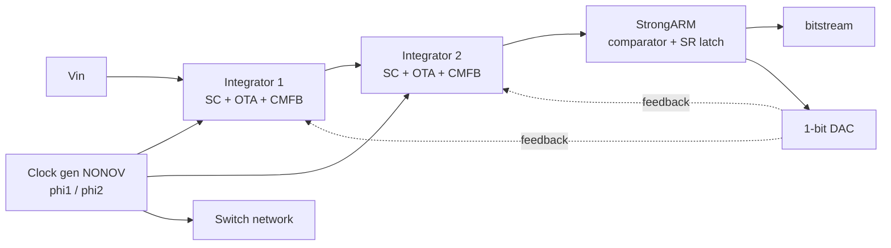

# Mixed-Signal Delta-Sigma ADC (SKY130)


Transistor-level design of a **1.8 V, 2nd-order, switched-capacitor, 1-bit Delta-Sigma modulator** in the open-source SKY130 PDK, from individual analog blocks to a closed-loop transistor-level simulation, with a Python flow that drives ngspice and extracts SNDR from the bitstream.

> **Scope, stated plainly:** all results below are **simulation, nominal corner (TT, 1.8 V, 27 C), pre-layout** unless a section says otherwise. Nothing here is silicon-proven or post-layout. Known limits are listed at the end, not hidden.

## Result in one table

Closed-loop transistor-level run, 300 mV sine input, OSR 80 (25 kHz bandwidth), 4112 clock cycles, 4096-point FFT:

| Configuration | SNDR @ OSR 80 |
|---|---|
| Ideal clock phases and comparator clock (Block 5 baseline) | 75.37 dB |
| Phases generated by Block 6 (NONOV), ideal comparator clock | 73.87 dB |
| Phases from Block 6 and comparator clock derived from its phi2b edge | 72.44 dB (ENOB 11.74 bit) |

System target (revised after analysis): **about 75 dB SNDR at OSR 80**. A 2nd-order 1-bit modulator cannot reach the original 99 dB at OSR 80, so the target was revised on that basis rather than claiming it. Noise shaping of order 2 is preserved in all three runs. The 1-3 dB differences between rows are at the level of single-run statistical scatter (about +-1 dB at OSR 80), so they are reported but not claimed as a degradation.

## Architecture



| # | Block | Content | Report |
|---|---|---|---|
| 1 | OTA | Two-stage fully differential amplifier (Rabii and Wooley style); 69.34 dB gain, 3.153 MHz UGF, 61.4 deg phase margin in the characterized configuration | [EN](blocks/01_OTA/docs/Block1_OTA_Report_EN.pdf) / [ID](blocks/01_OTA/docs/Block1_OTA_Report_ID.pdf) |
| 2 | SC-CMFB | Switched-capacitor common-mode feedback | [EN](blocks/02_CMFB/docs/Block2_SC_CMFB_Report_EN.pdf) / [ID](blocks/02_CMFB/docs/Block2_SC_CMFB_Report_ID.pdf) |
| 3 | StrongARM + SR latch | Dynamic comparator | [EN](blocks/03_StrongARM/docs/Block3_StrongARM_Report_EN.pdf) / [ID](blocks/03_StrongARM/docs/Block3_StrongARM_Report_ID.pdf) |
| 4 | 1-bit DAC | Rail-to-rail feedback multiplexer | [EN](blocks/04_1Bit_DAC/docs/Block4_DAC_Report_EN.pdf) / [ID](blocks/04_1Bit_DAC/docs/Block4_DAC_Report_ID.pdf) |
| 5 | Switch network | CMOS transmission gates, charge-injection and hold-error analysis | [EN](blocks/05_Switch_Network/docs/Block5_SwitchNetwork_Report_EN.pdf) / [ID](blocks/05_Switch_Network/docs/Block5_SwitchNetwork_Report_ID.pdf) |
| 6 | Clock generator (NONOV) | Feedback-free non-overlapping two-phase generator after Spilka et al., DDECS 2012; current-starved delay cells, 80 MOS | closure report in `blocks/06_Clock_gen/docs/` |

Every block was closed with an explicit scope statement and measured numbers labelled `MEASURED_NOT_FINAL` or `SIMULATED_NOT_FINAL_PASS`, never an unqualified "pass".

## Block 6 in numbers (nominal)

Non-overlap gap 14.3 ns, phase width 110.6 ns (T = 250 ns), zero overlap, edges 0.3-0.8 ns. Wire loads of 50/200/500 fF keep the gap at 14.3-14.7 ns with no overlap.

**PVT baseline (ideal fixed bias, VBN 0.70 V / VBP 0.71 V), 45 conditions** (5 corners x -40/27/125 C x 1.62/1.8/1.98 V): zero overlap in all 35 conditions where the clock runs, but only 17 of 45 meet gap >= 5 ns and width >= 100 ns; 10 conditions stop producing phases (cold or low VDD), 18 fail on a collapsed gap (hot, high VDD) or a clipped width. The delay cell is very sensitive to bias at fixed gate voltage, so a PVT-tracking bias generator is the identified next step; a bias map that finds VBN/VBP per condition is in progress. This is recorded as a known limit, not as a pass.

## Repository structure

```
blocks/01_OTA ... 06_Clock_gen   schematics (xschem), testbenches, per-block docs
top_level/closed_loop            closed-loop modulator runs, Python drivers, results
tools/                           Python generators and runners for the testbenches
docs/README.md                   index of the block reports
```

## Reproducing

Needs xschem, ngspice (46) and the SKY130A PDK. Block 6 example, from the repository root:

```
python3 tools/run_block6.py selftest
python3 tools/run_block6.py netlist --xschem <path-to-xschem>
python3 tools/run_block6.py sim
python3 tools/run_block6.py analyze
```

Closed-loop drivers are documented in `top_level/closed_loop/README.md`. Large raw waveform files are not committed (see `.gitignore`).

## Known limits

- Nominal corner and pre-layout only for Blocks 1-5; Block 6 additionally has the PVT baseline above. No Monte Carlo, no mismatch, no post-layout, no transient noise in the decks.
- Bias voltages (VBN/VBP, OTA bias) are ideal sources; no bias generator yet.
- Closed loop: one amplitude (-6 dBFS), one bin, one run per configuration; single-run SNDR scatter is about +-1 dB at OSR 80 and about 3 dB at OSR 16.
- The OTA inside the loop is not exactly the OTA characterized in Block 1 (different Cc and bias); Block 1 numbers do not transfer automatically.
- The comparator clock derived from phi2b uses an inverter chain (N = 2, 0.46 ns); a deliberately designed comparator delay is not done.

## Roadmap (not in this repository yet)

Digital back end: Verilog CIC decimation filter (no multipliers), self-checking Icarus testbench reading the analog bitstream, Gowin synthesis and place-and-route for the Tang Nano 20K, analog reconstruction through an R-2R DAC. Then: bias generator for Block 6, Monte Carlo, layout.

## License

See [LICENSE](LICENSE).
