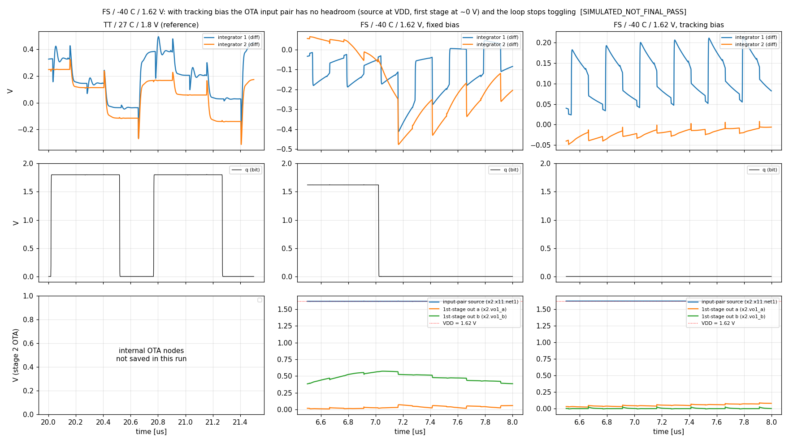
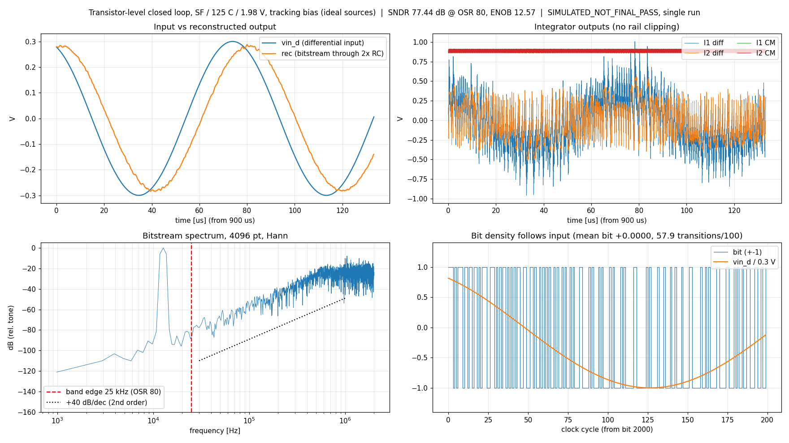

# Corner study of the closed loop (runs f7): causes and evidence

**Status: `SIMULATED_NOT_FINAL_PASS`.** Transistor-level ngspice, pre-layout, ideal bias sources (fixed or re-computed per corner), no transient noise, one run per configuration. This is a diagnosis, not a PVT sign-off. The design is **not** robust over corners yet.

## Summary

| Corner | Bias | SNDR @ OSR 80 | Verdict |
|---|---|---|---|
| TT / 27 C / 1.8 V (f6, reference) | fixed (nominal) | 73.62 dB | works |
| SF / 125 C / 1.98 V (f7) | fixed (nominal values) | 28.17 dB | fails: bias currents 4-92x too high, integrators clip |
| SF / 125 C / 1.98 V | **tracking** (re-computed per corner) | **77.44 dB** | works again |
| FS / -40 C / 1.62 V (f7) | fixed (nominal values) | 33.58 dB | fails |
| FS / -40 C / 1.62 V | tracking | not computed | fails: OTA input pair has no headroom, loop stops toggling |

Two different causes:
1. **SF: fixed bias voltages do not track PVT.** Re-computing the bias voltages for the nominal currents restores the loop. Fix: an on-chip bias generator (not designed yet).
2. **FS: input common-mode headroom of the OTA.** The PMOS input pair needs about 0.91 V source-gate voltage at this corner but has only 0.72 V at the 0.9 V common mode. No bias setting can fix this; it needs a circuit change (candidate: low-Vt PMOS input pair, see below).

The single-run scatter is about +-1 dB (up to 3 dB between runs at OSR 80), so 77.4 dB at SF versus 73.6 dB at TT is **not** a claimed improvement.

## 1. DC evidence: fixed bias versus corners

Replica devices of the bias branches at the nominal bias voltages (VBIAS 0.58 V, VCMS 0.604 V, VCS 0.926 V):

| Current with fixed bias | TT / 27 / 1.8 | FS / -40 / 1.62 | SF / 125 / 1.98 |
|---|---|---|---|
| M3 (VBIAS, W8 L2) | 1.55 uA | 0.19 uA | 6.3 uA |
| M11 (VCMS, W80 L1) | 32.0 uA | 5.0 uA | 117 uA |
| M13 (VCS, W480 L1.2) | 3.29 uA | 0.002 uA | 302 uA |

Bias voltages that give the nominal currents again ("tracking bias", ideal sources):

| Voltage | TT | FS / -40 / 1.62 | SF / 125 / 1.98 |
|---|---|---|---|
| VBIAS | 0.580 | 0.6569 | 0.4851 |
| VCMS | 0.6035 | 0.6748 | 0.5171 |
| VCS | 0.9259 | 0.6405 | 1.2570 |
| VBZ | 1.8 | 1.62 (= VDD) | 1.98 (= VDD) |

## 2. Transient evidence (90 us runs of the system testbench `tb_SD_TOP`)

The old f7 runs were reproduced with `top_level/xschem/tb_SD_TOP.sch` (SF: bit-identical, 340/340 bits; FS: same statistics), then rerun with tracking bias.

| Metric (10-90 us) | TT (reference) | SF fixed bias | SF tracking bias |
|---|---|---|---|
| Bit transitions per 100 cycles | 58.0 | 15.0 | 56.4 |
| Bit density per volt of input (ideal 0.833) | 0.827 | 0.810 | 0.827 |
| Correlation bit density vs input | 0.990 | 0.922 | 0.988 |
| Integrator 1 common mode (mean) | 0.90 V | 0.36 V | 0.89 V |
| Integrator 2, single-ended range | 0.66-1.16 V | -0.01-2.03 V (clipped) | 0.60-1.20 V |

FS with tracking bias: 0.6 transitions per 100 cycles (the loop is stuck). Internal nodes of the stage-2 OTA (figure below): the source of the PMOS input pair sits at VDD and the first-stage outputs at about 0 V, so the OTA has no gain. With fixed bias the wrong bias happens to leave a little current, which is why that run still gives 33.6 dB.

## 3. Full SNDR run: SF / 125 C / 1.98 V with tracking bias

1.03325 ms transient (about 4.4 h), 4096 bits after reset and 16 warm-up cycles, coherent bin 13, Hann window.

| OSR | SNDR | ENOB |
|---|---|---|
| 80 | 77.44 dB | 12.57 |
| 32 | 55.62 dB | 8.95 |
| 16 | 38.46 dB | 6.10 |

Clean bit levels, 57.9 transitions per 100 cycles, integrator common modes 0.885 / 0.886 V, differential swings +-1.05 V (I1) and +-0.61 V (I2). Order-2 noise shaping (+40 dB/decade) is visible in the spectrum.

For comparison, the fixed-bias spectra of the original f7 runs: [FS](figures/f7_fs_fixedbias_psd.png), [SF](figures/f7_sf_fixedbias_psd.png); TT reference: [f6](figures/f6_psd.png).

## 4. FS headroom: DC numbers and a candidate fix

Input PMOS of the OTA (W240 L0.6), source forced to VDD (best case, no tail drop), drain at 0.4 V. "Max input CM" = VDD minus the source-gate voltage needed for the nominal 1.55 uA.

| Corner | Device | Vsg for 1.55 uA | Max input CM |
|---|---|---|---|
| TT / 27 / 1.8 | pfet_01v8 (current design) | 0.800 V | 1.000 V |
| FS / -40 / 1.62 | pfet_01v8 | 0.914 V | **0.706 V** (< 0.9 V needed) |
| SS / -40 / 1.62 | pfet_01v8 | 0.974 V | 0.646 V |
| FS / -40 / 1.62 | pfet_01v8_lvt (candidate) | 0.232 V | 1.388 V |
| SS / -40 / 1.62 | pfet_01v8_lvt (candidate) | 0.476 V | 1.144 V |

A low-Vt input pair removes the headroom limit in DC. It is **not** verified in the OTA (gain, offset, operating region, sizing at this current) or in the closed loop; that is future work. Other options: a lower integrator input common mode, or a higher minimum supply.

## 5. What is not done

- No real bias generator; all bias voltages are ideal sources.
- No closed-loop run of a fixed FS design.
- FF and SS corners, and the other temperatures and supplies, are not run in the closed loop.
- No Monte Carlo of the loop, no transient noise, no layout.

## Files

| File | Content |
|---|---|
| `top_level/xschem/tb_SD_TOP.sch` | System testbench used for the 90 us reproductions |
| `top_level/closed_loop/tools/plot_fs_debug.py` | Generates `figures/fs_corner_debug.png` from the debug raw files |
| `top_level/closed_loop/tools/corner/sndr_sf.py` | SNDR from the 1.03 ms SF tracking-bias raw file |
| `top_level/closed_loop/tools/corner/fs_lvt_check.py` | DC check of regular versus low-Vt input PMOS per corner |
| `top_level/closed_loop/results/closed_loop/f7_*/metrics.json` | Metrics of the original fixed-bias f7 runs |

Raw waveform files (`top_level/xschem/sim_out/`) are not committed.
