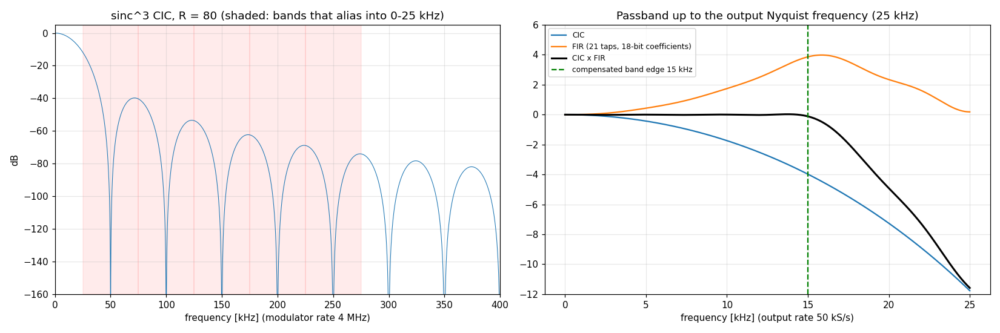
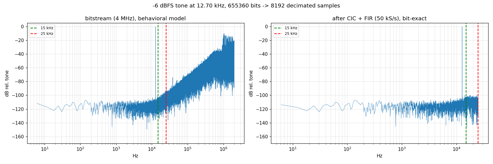
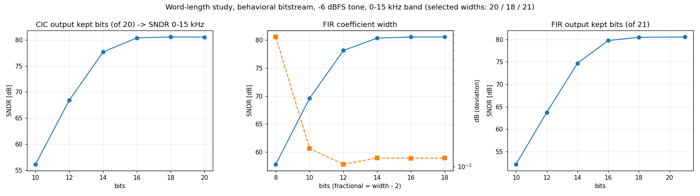
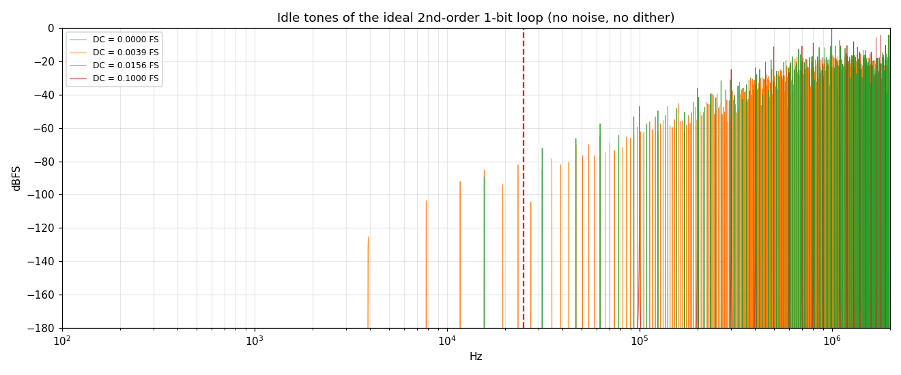
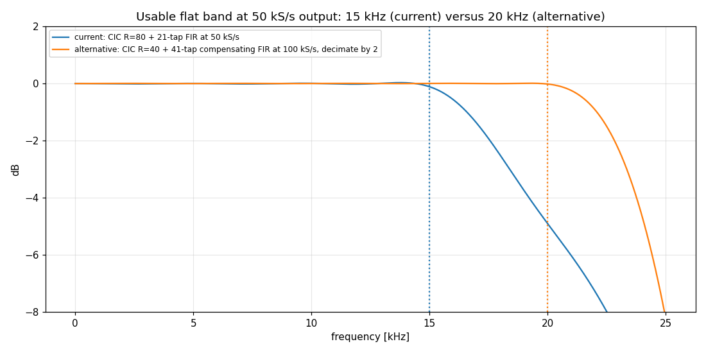

# DSP analysis of the decimation chain

Bitstream (1 bit, 4 MHz) -> sinc^3 CIC, R = 80 (Block 7) -> 21-tap compensation FIR (Block 8) -> 50 kS/s.

**Status: `SIMULATED_NOT_FINAL_PASS`.** Filter responses are exact math on the implemented coefficients. Every SNDR, word-length, idle-tone and aliasing number below uses the bit-exact Python models of Blocks 7 and 8 driven by the **ideal behavioral modulator** (2nd order, coefficients 0.5, kT/C noise for Cs = Cd = 1 pF), not the transistor-level circuit, unless the row says "f6". The transistor-level bitstream f6 has only 4096 bits (51 decimated samples), which is too short for decimated-domain spectra.

Reproduce (about 40 s): `python3 top_level/dsp_analysis/dsp_analysis.py`, writes `figures/` and `results.json`.

## Key results

| Question | Answer |
|---|---|
| Does the decimation chain degrade SNDR? | **0.2-0.45 dB** loss in the 0-15 kHz band (6 cases: 1 kHz and 12.7 kHz, -6/-20/-40 dBFS) |
| How much out-of-band noise aliases into the band? | Aliased noise is **49 dB** below the native in-band noise for 0-15 kHz, 39 dB for 0-25 kHz |
| Are the word lengths justified? | Yes, with margin: CIC 20 bits (needed: 1 + 3 log2 80 = 19.97), coefficients 18 bits (14 would do), output 21 bits (18 would do) |
| Is the full 25 kHz band usable after decimation? | **No.** At 50 kS/s the band edge equals the output Nyquist frequency. The chain is flat (+0.03/-0.12 dB) only up to 15 kHz; it is -4.9 dB at 20 kHz and -11.6 dB at 25 kHz |
| Fix? | CIC R = 40 + compensating FIR at 100 kS/s, decimate by 2: flat to 20 kHz (+0.01/-0.02 dB), at least 71 dB rejection 30-50 kHz |

The "SNDR at OSR 80 (25 kHz)" quoted for the modulator is computed from the bitstream with an ideal brick-wall band limit. It is the modulator figure, not what the present 50 kS/s decimator delivers over 25 kHz.

## A. Frequency responses

CIC droop: -3.98 dB at 15 kHz, -11.77 dB at 25 kHz. The FIR boosts by up to +3.98 dB to compensate; CIC x FIR is +0.028/-0.115 dB on 0-15 kHz. The CIC nulls sit at multiples of 50 kHz, which are exactly the centers of the bands that fold back into the signal band (shaded).

## B. Aliasing

Minimum CIC attenuation in the bands that fold onto the signal band (k x 50 kHz +- band edge):

| Fold band | 0-15 kHz band | 0-25 kHz band |
|---|---|---|
| k = 1 (35-65 kHz / 25-75 kHz) | 26.1 dB | 11.8 dB |
| k = 2 | 49.2 dB | 40.4 dB |

The k = 1 attenuation looks small, but the modulator noise there is still low (2nd-order shaping), so the total folded noise is small. Noise budget from the PSD of a 655 360-bit behavioral run, weighted by |CIC x FIR|^2 and folded: aliased / native in-band noise = **-48.8 dB** (15 kHz band) and -38.6 dB (25 kHz band). This is the reason a 3rd-order CIC is used after a 2nd-order modulator (CIC order >= modulator order + 1).

## C. SNDR before and after decimation

| Tone | Level | Bitstream, 0-25 kHz | Bitstream, 0-15 kHz | After CIC + FIR, 0-15 kHz | Loss |
|---|---|---|---|---|---|
| 1.01 kHz | -6 dBFS | 73.8 dB | 80.9 dB | 80.5 dB | 0.45 dB |
| 1.01 kHz | -20 dBFS | 61.6 dB | 67.7 dB | 67.4 dB | 0.21 dB |
| 1.01 kHz | -40 dBFS | 40.3 dB | 47.5 dB | 47.1 dB | 0.35 dB |
| 12.70 kHz | -6 dBFS | 73.6 dB | 80.9 dB | 80.5 dB | 0.39 dB |
| 12.70 kHz | -20 dBFS | 61.6 dB | 67.6 dB | 67.4 dB | 0.22 dB |
| 12.70 kHz | -40 dBFS | 41.9 dB | 47.7 dB | 47.5 dB | 0.22 dB |

## D. Word lengths

SNDR in 0-15 kHz after the full chain, -6 dBFS tone (reference with the implemented widths: 80.5 dB):

| Varied | 10 | 12 | 14 | 16 | 18 | implemented |
|---|---|---|---|---|---|---|
| CIC output bits kept (of 20) | 56.2 | 68.4 | 77.7 | 80.4 | 80.6 | 80.5 (20) |
| FIR coefficient width (fraction = width - 2) | 69.6 | 78.1 | 80.4 | 80.6 | 80.5 | 80.5 (18) |
| FIR output bits kept (of 21) | 52.2 | 63.8 | 74.7 | 79.8 | 80.5 | 80.5 (21) |

The CIC registers themselves cannot be narrower than 20 bits without pruning (output magnitude up to R^3 = 512 000). The 18-bit coefficient width was chosen to match the Gowin 18x18 multiplier; 14 bits would meet this SNDR. The output could be cut to 18 bits. Against the transistor-level modulator (lower SNDR) the margins are larger.

## E. Idle tones

Small DC inputs make the ideal 1-bit 2nd-order loop periodic, which produces tones:

| DC input | Largest in-band (0-25 kHz) tone, no noise | With kT/C noise (1 pF) |
|---|---|---|
| 0 | none | - |
| 1/256 FS | -82.1 dBFS at 23.4 kHz | -84.7 dBFS |
| 1/64 FS | -89.2 dBFS at 15.6 kHz | -100.0 dBFS |
| 0.1 FS | none | - |

The tones are 80-90 dB below full scale, i.e. below the in-band noise floor at OSR 80 for a -6 dBFS signal but visible in long FFTs of small DC inputs. Thermal noise acts as a weak dither. Not examined: the transistor-level loop, and dither injection.

## F. Spectral-estimation method

Same behavioral bitstream (32 768 bits, -6 dBFS), SNDR in 0-25 kHz:

| Window | Coherent tone | Tone between bins |
|---|---|---|
| Rectangular | 72.7 dB | 15.4 dB (leakage) |
| Hann | 74.8 dB | 56.3 dB |
| Blackman-Harris | 75.2 dB | 72.8 dB |

All SNDR numbers in this repository use coherent sampling (odd integer number of cycles) with a Hann window, where the choice of window changes the result by less than 0.5 dB. A non-coherent measurement on real hardware will need a Blackman-Harris window or a sine fit.

## G. Alternative chain for a usable 20 kHz band

| Chain | Flat band | Deviation in band | Multipliers | SNDR 0-20 kHz (behavioral) |
|---|---|---|---|---|
| Current: CIC R = 80 + 21-tap FIR at 50 kS/s | 15 kHz | +0.03/-0.12 dB (0-15 kHz); -4.9 dB at 20 kHz | 1 (serial) | 77.5 dB |
| Alternative: CIC R = 40 + 41-tap compensating FIR at 100 kS/s, decimate by 2 | 20 kHz | +0.01/-0.02 dB | 1 (serial, 41 taps x 50 kS/s = 2.05 M MAC/s) | 77.0 dB |

The SNDR is the same; the difference is the flat bandwidth. (The current chain's SNDR over 0-20 kHz is not lower because its droop above 15 kHz attenuates noise as well as signal; a tone at 20 kHz would be 4.9 dB low.) The alternative FIR is a least-squares design in floating point, not a true half-band filter; a half-band structure with every second tap zero would halve the multiplications. It is **not implemented in RTL**.

## H. Cross-check on the transistor-level bitstream (f6)

4096 bits, tone at 12.695 kHz: SNDR 73.62 dB (0-25 kHz) from the bitstream; the 0-15 kHz value (92.0 dB) rests on only 6 noise bins and is not meaningful. The integer CIC model in this script equals the bit-exact wrap-around model (`cic_bitexact`) on all 51 samples. CIC + FIR on this bitstream is verified bit-exact against the RTL in Block 8.

## Files

| File | Content |
|---|---|
| `dsp_analysis.py` | All sections A-H; imports `cic_ref.py`, `fir_ref.py`, `sd_behavioral.py` |
| `results.json` | All numbers above |
| `figures/` | A_responses, C_spectra, D_wordlength, E_idle_tones, G_alternative |
